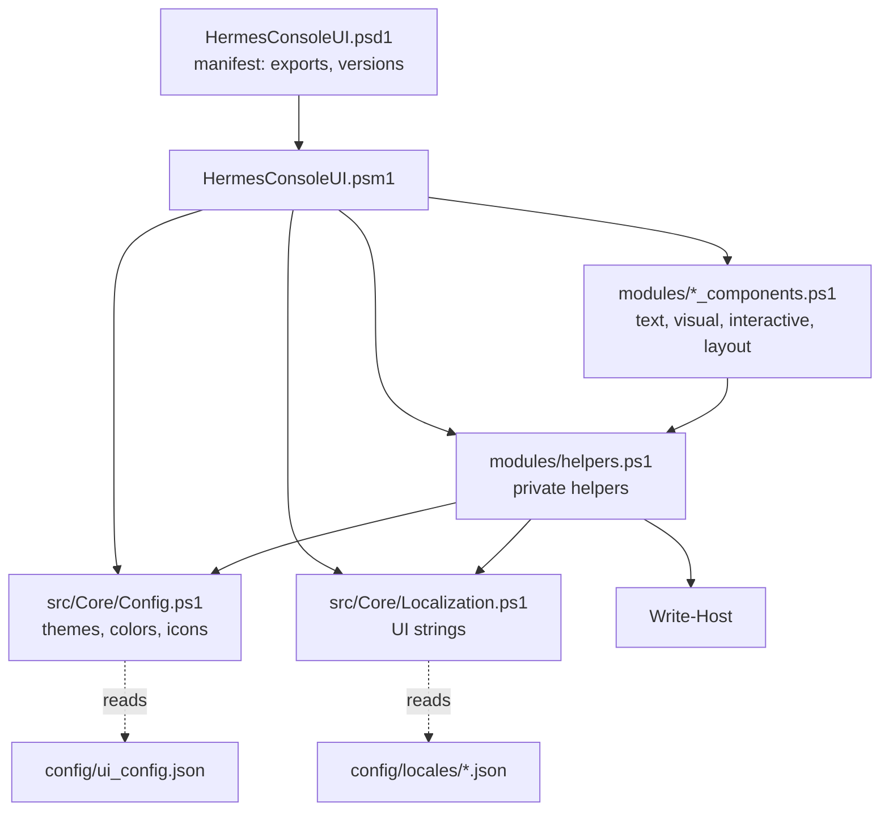

# Architecture

HermesConsoleUI is a script module. `HermesConsoleUI.psm1` dot-sources every source file into the
module scope, initializes the configuration and localization, and exports the public commands
listed in the manifest. Nothing is loaded into the global scope.

## Files

| Path | Contents |
|---|---|
| `src/Core/Config.ps1` | Loads `config/ui_config.json`; theme commands (`Set-ConsoleTheme`, `Get-UIColor`, ...). |
| `src/Core/Localization.ps1` | Loads `config/locales/*.json`; locale commands (`Set-UILocale`, `Get-LocalizedString`, ...). |
| `modules/helpers.ps1` | Private helpers: safe output, theme and locale lookup, centering, icons, layout merge. |
| `modules/text_components.ps1` | Titles, headers, status, error and info lines, metadata, summary, diff, separator, breadcrumb. |
| `modules/visual_components.ps1` | Lists, trees, charts, sparklines, panels, boxes and tables. |
| `modules/interactive_components.ps1` | Menus, choices, prompts, spinner, progress and notifications. |
| `modules/layout_components.ps1` | Side-by-side layouts. |

## How a component writes

Every component follows the same three steps:

1. **Colors.** Each color parameter goes through `Resolve-UIColor`: an explicit `-Color` is used as
   given, otherwise the color for that role (Primary, Success, Muted, ...) comes from the active theme.
2. **Texts.** Prompts and fixed messages come from `Get-UIText`, which reads the active locale and
   falls back to English.
3. **Output.** Text is written with `Write-HermesHost`, which removes ANSI escape sequences and
   control characters (`ConvertTo-ConsoleSafeText`) before calling `Write-Host`. This keeps data
   such as file names or log lines from restyling the console or overwriting earlier lines.

Components that can be embedded in panels or layouts also accept `-ReturnLines` and then return
their lines instead of writing them.

## Encoding

Windows PowerShell 5.1 reads files without a byte order mark as ANSI. Source files that contain
non-ASCII characters are saved as UTF-8 with BOM, and the JSON files are read with
`-Encoding UTF8`. The QA tests check both.

## Package

`build.ps1` copies only the runtime files (manifest, root module, `src`, `modules`, `config`,
`LICENSE`, `README.md`) into `output/HermesConsoleUI`. That folder is what CI installs with
`Install-Module` and what the `Publish` workflow sends to the PowerShell Gallery.
