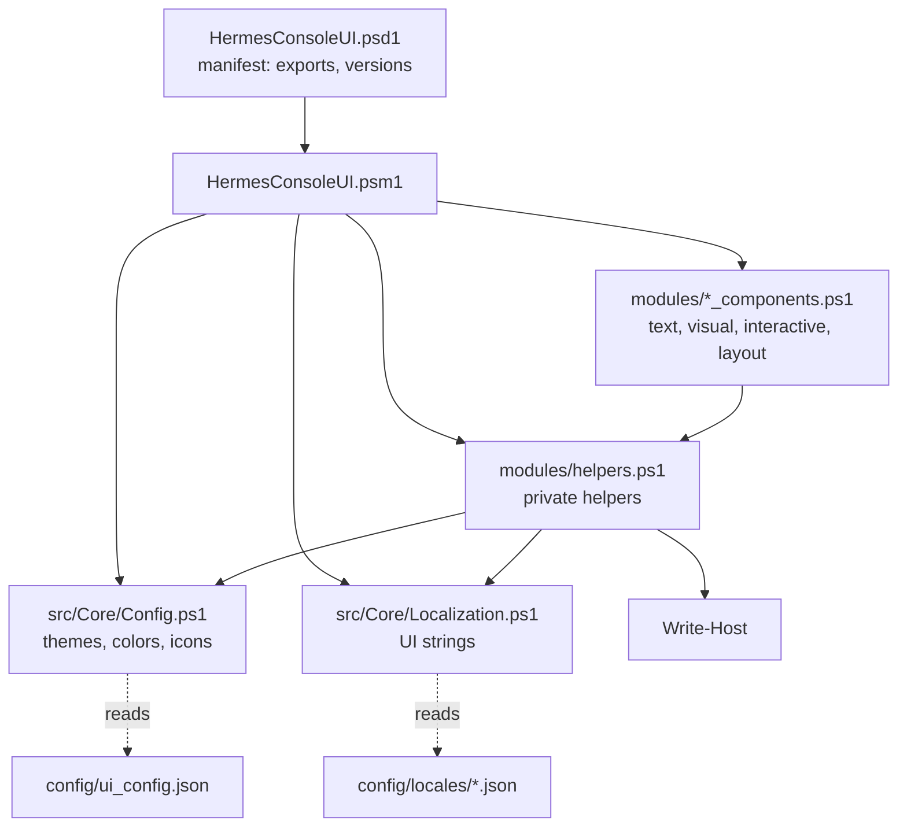

# Architecture

HermesConsoleUI is a script module. `HermesConsoleUI.psm1` dot-sources every source file into the
module scope, initializes the configuration and localization, and exports the public commands
listed in the manifest. Nothing is loaded into the global scope.

## Files

| Path | Contents |
|---|---|
| `src/Core/Config.ps1` | Loads `config/ui_config.json`; theme commands (`Set-ConsoleTheme`, `Get-UIColor`, ...). |
| `src/Core/Localization.ps1` | Loads `config/locales/*.json`; locale commands (`Set-UILocale`, `Get-LocalizedString`, ...). |
| `modules/helpers.ps1` | Private helpers: safe output, theme and locale lookup, centering, icons, layout merge. |
| `modules/text_components.ps1` | Titles, headers, status, error and info lines, metadata, summary, diff, separator, breadcrumb. |
| `modules/visual_components.ps1` | Lists, trees, charts, sparklines, panels, boxes and tables. |
| `modules/interactive_components.ps1` | Menus, choices, prompts, spinner, progress and notifications. |
| `modules/layout_components.ps1` | Side-by-side layouts. |

## How a component writes

Every component follows the same three steps:

1. **Colors.** Each color parameter goes through `Resolve-UIColor`: an explicit `-Color` is used as
   given, otherwise the color for that role (Primary, Success, Muted, ...) comes from the active theme.
2. **Texts.** Prompts and fixed messages come from `Get-UIText`, which reads the active locale and
   falls back to English.
3. **Output.** Text is written with `Write-HermesHost`, which removes ANSI escape sequences and
   control characters (`ConvertTo-ConsoleSafeText`) before calling `Write-Host`. This keeps data
   such as file names or log lines from restyling the console or overwriting earlier lines.

Components that can be embedded in panels or layouts also accept `-ReturnLines` and then return
their lines instead of writing them.

## Configuration

`config/ui_config.json` is merged over the built-in settings in `src/Core/Config.ps1`
(`$script:DefaultConfig`), so a file only needs what it changes. Both contain only settings the module
reads: the themes (`ColorScheme`, `ActiveTheme`), the status icons of `Get-UIIcon` and
`Components.Table.MaxColumnWidth`. A setting that nothing reads misleads whoever edits the file: add a
setting together with the code that reads it.

## Adding a component

1. Put it in the `modules/*_components.ps1` file of its kind, as an advanced function with complete
   comment-based help: synopsis, description, every parameter and at least one example (the QA tests
   check it).
2. Write only through `Write-HermesHost`, never `Write-Host`, so control sequences are removed, `NO_COLOR`
   is honoured and the output handler receives a copy.
3. Take colors with `Resolve-UIColor -Color $Color -Role <role>`, one of the roles in
   `$script:HermesColorRoles`, so the component follows the theme and an explicit `-Color` still wins.
4. Take fixed texts with `Get-UIText -Key <Section.Key> -Default '<English>'`, and add the key to every file
   in `config/locales` (a test checks they all have the same keys as `en-US.json`).
5. If it draws lines that could go inside a panel or a layout column, add `-ReturnLines` and return the
   lines instead of writing them.
6. If it reads input, end when redirected input runs out (`Read-Host` returns `$null` and
   `Test-HermesInputRedirected` is true): return the default or throw, never ask again forever.
7. Export it in both `HermesConsoleUI.psm1` and `FunctionsToExport` in `HermesConsoleUI.psd1`, add it to
   the commands table in the README and a line to the changelog, and add tests in `tests/Unit`.

## Encoding

Windows PowerShell 5.1 reads files without a byte order mark as ANSI. Source files that contain
non-ASCII characters are saved as UTF-8 with BOM, and the JSON files are read with
`-Encoding UTF8`. The QA tests check both.

## Package

`build.ps1` copies only the runtime files (manifest, root module, `src`, `modules`, `config`,
`LICENSE`, `README.md`) into `output/HermesConsoleUI`. That folder is what CI installs with
`Install-Module` and what the `Publish` workflow sends to the PowerShell Gallery.
